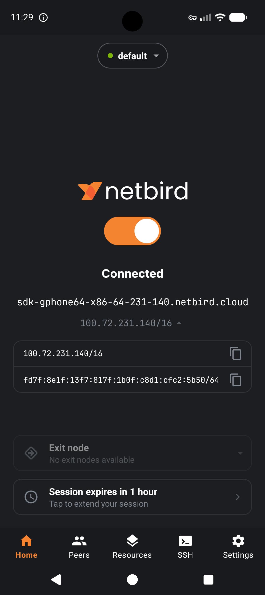
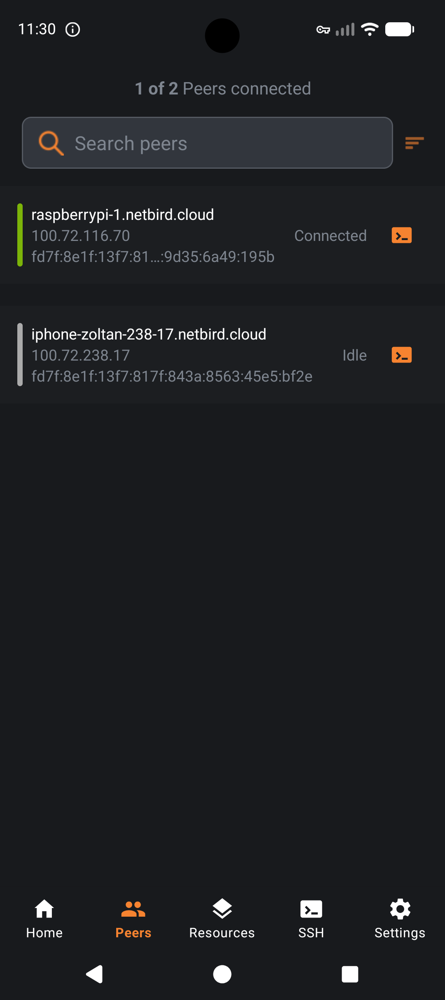
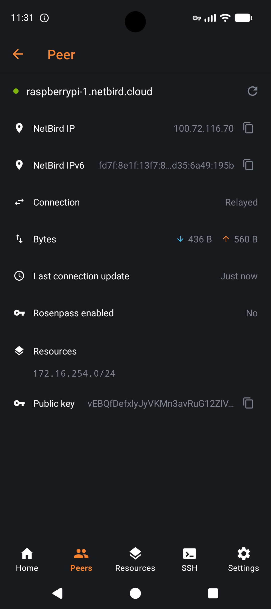

<br/>
<div align="center">
<p align="center">
  
</p>
  <p>
     <a href="LICENSE">
       
     </a>
  </p>
</div>

# NetBird Home (custom NetBird Android client)

A personal fork of the official [NetBird Android client](https://github.com/netbirdio/android-client)
with background network automation. It is **not** affiliated with or endorsed by NetBird.
For the NetBird service itself see the [official documentation](https://docs.netbird.io/).

## What's different from the official app

- **Auto-disconnect on Wi-Fi:** NetBird is turned off when you connect to Wi-Fi. Optionally, list one or more
  trusted SSIDs (comma-separated) so it only disconnects on those networks, e.g. your home Wi-Fi.
- **Auto-connect on mobile data:** NetBird is turned on when the device switches to cellular (4G/5G).
  It is skipped if you disconnected manually.
- **Side-by-side install:** the app uses the package ID `io.netbird.client.custom` and the name **NetBird Home**,
  so it can be installed next to the official NetBird app.

Both automation options live in the app under **Advanced** and are off by default.

> Reading the Wi-Fi name requires the location permission on Android 10+. The app asks for it when you
> enable the trusted-SSID filter.

## Screenshots

<p align="center">
  
  
  
</p>

## Install

There is no prebuilt APK and the app is not published on Google Play. To use it you have to build it
yourself from source, see [Building from source](#building-from-source) below.

## Building from source

### Requirements

- Git
- JDK (the one bundled with Android Studio is fine)
- Android SDK with command-line tools (usually installed via Android Studio)
- Android NDK `23.1.7779620`
- [Go](https://go.dev/dl/) (used by `build-android-lib.sh` to build the NetBird core with `gomobile`)

### 1. Clone with submodules

```shell
git clone --recurse-submodules https://github.com/gontargod/netbird-android-home.git
cd netbird-android-home
```

If you already cloned without submodules:

```shell
git submodule update --init --recursive
```

### 2. Set environment variables

Adjust the paths to your system (Linux example):

```shell
export ANDROID_HOME=$HOME/Android/Sdk
export JAVA_HOME=/path/to/android-studio/jbr
```

On macOS they are typically:

```shell
export ANDROID_HOME=$HOME/Library/Android/sdk
export JAVA_HOME="/Applications/Android Studio.app/Contents/jbr/Contents/Home"
```

### 3. Install the NDK

```shell
$ANDROID_HOME/cmdline-tools/latest/bin/sdkmanager --install "ndk;23.1.7779620"
```

### 4. Build the Go core library

```shell
./build-android-lib.sh
```

This produces `gomobile/netbird.aar`.

### 5. Build the app

Debug APK:

```shell
./gradlew assembleDebug -PversionCode=1 -PversionName=1.0.0
```

The APK ends up in `app/build/outputs/apk/debug/`.

Debug bundle:

```shell
./gradlew bundleDebug -PversionCode=1 -PversionName=1.0.0
```

To build under a different package ID, pass `-PNETBIRD_APPLICATION_ID=your.package.id`
(or set it as an environment variable). The default is `io.netbird.client.custom`.

## Reporting bugs

- Problems with the automation features or anything specific to this fork: open an
  [issue in this repository](../../issues).
- Problems with the NetBird client or service in general: use the
  [NetBird Discussions](https://github.com/netbirdio/netbird/discussions), which is how the upstream project
  handles bug reports and feature requests.

## License and credits

Based on the official [NetBird Android client](https://github.com/netbirdio/android-client) and the
[NetBird](https://github.com/netbirdio/netbird) core. Licensed under the
[GNU General Public License v3.0](LICENSE), same as upstream.
